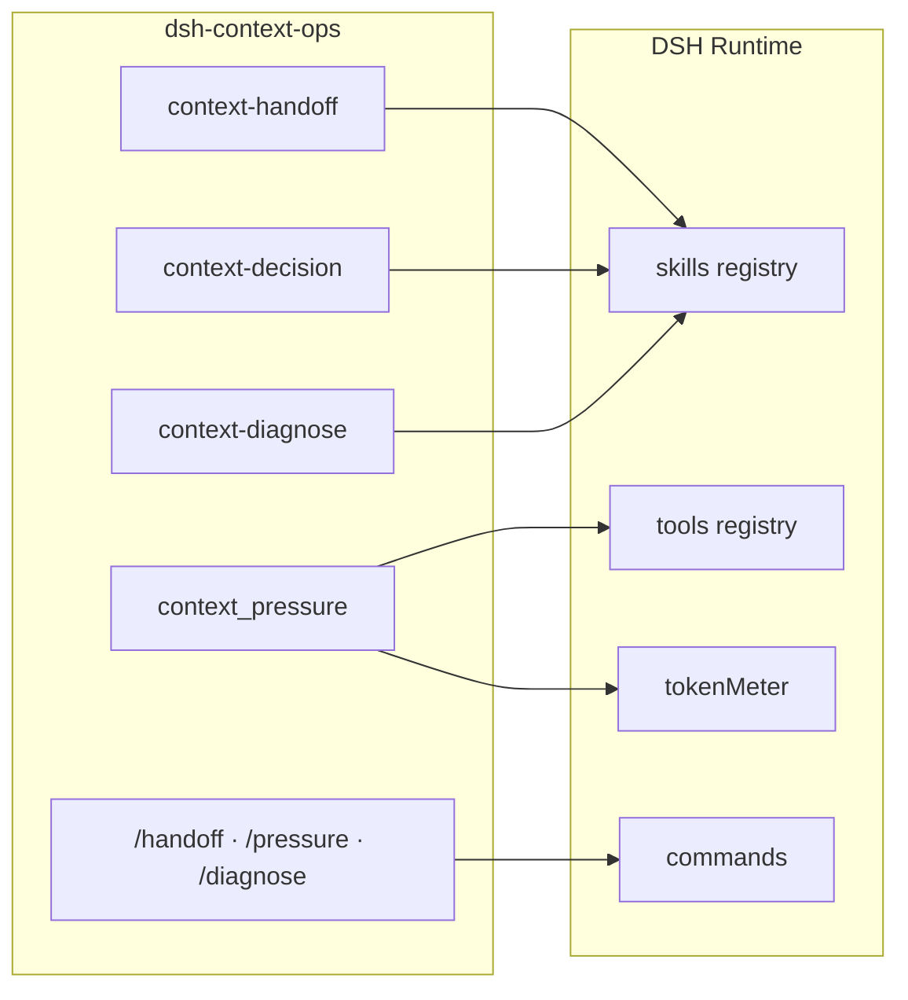
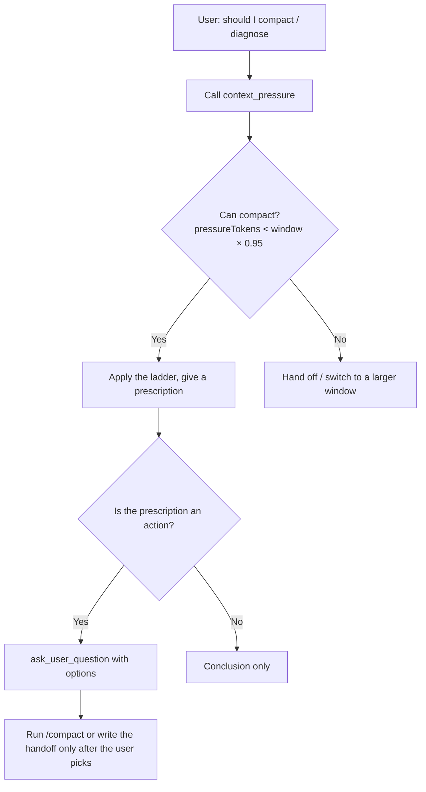

<p align="center">
  
</p>

<p align="center">
  
  
  
  
</p>

<h1 align="center">dsh-context-ops</h1>

<p align="center">
  A <a href="https://github.com/deepseek-ai/deepseek-harness">DeepSeek Harness</a> (<code>dsh</code>) plugin for context management:<br>
  <b>handoff</b>, <b>compaction decision</b> and <b>diagnosis</b> skills, a self-contained <b>pressure tool</b>, and three <b>slash commands</b>.
</p>

> 中文版见 [README.md](README.md)。

---

## Why this plugin

| Problem | What it does |
|---|---|
| Sessions get slower but you don't know when to compact | "Should I compact?" → reads `context_pressure`, applies the ladder, gives one prescription |
| Compaction loses constraints / fails, without a clear reason | "Context diagnosis" → layer-by-layer check + hard rule + three failure causes |
| You re-read old chats across days or sessions | "Handoff" → a 5-line brief written to `CHECKPOINT.md` |
| Readings depend on a machine-specific external script | `context_pressure` reads DSH's built-in `tokenMeter`, so it works anywhere |
| Switching models then compacting still uses the old model | The diagnosis skill says: run one normal turn first, then `/compact` |

## Features

| Capability | Name | Implementation | Notes |
|---|---|---|---|
| Handoff skill | `context-handoff` | `lib/skills/handoff.js` | Writes a 5-line brief (goal / status / next / open / evidence) to `CHECKPOINT.md` |
| Decision skill | `context-decision` | `lib/skills/decision.js` | Reads numbers → applies the ladder → gives **one** prescription |
| Diagnosis skill | `context-diagnose` | `lib/skills/diagnose.js` | One check-up, layer by layer, **full report** |
| Pressure tool | `context_pressure` | `lib/index.js` | Self-contained, reads DSH's built-in `tokenMeter` |
| Slash commands | `/handoff` `/pressure` `/diagnose` | `lib/index.js` | Explicit triggers (skipped when no `commands` service) |
| Compaction model | `compaction-basic` config | documented below | Native DSH fields; **no hard-coded provider/model** |

## Quick start

```sh
# 1) Install (replace <profile> with yours, e.g. desktop / web)
dsh plugin --profile <profile> add dsh-context-ops

# 2) Restart DSH (profile changes take effect on restart)

# 3) Try a trigger
#    "handoff" / "should I compact?" / "context diagnosis"
#    or the slash commands: /handoff  /pressure  /diagnose
```

Local development install:

```sh
dsh plugin --profile <profile> add "file:/absolute/path/to/dsh-context-ops"
```

## Skills

### 1) Handoff `context-handoff`

**Triggers**: handoff, wrap up, archive, checkpoint, resume project, continue last night's project.

**Output**: a five-line `CHECKPOINT.md` table — goal, status, next steps, open questions, evidence.

**When not to use**: 1–2 turn tasks, pure Q&A with no project state, or when the user explicitly says no brief.

### 2) Context decision `context-decision`

**Triggers**: context management, should I compact, should I hand off, what about the context, how much pressure, how much room left.

**Flow**: call `context_pressure` for real numbers, then apply the ladder and give one prescription (what + why + which number).

### 3) Context diagnosis `context-diagnose`

**Triggers**: context diagnosis, diagnose, context check-up, check-up, ctx-check, take a look at my context.

**Output**: a diagnosis report (status / band / can-compact / should-compact / warnings), with clickable options.

## The `context_pressure` tool

Called with no arguments, it returns:

```json
{
  "pressureTokens": 82341,
  "surfaceTokens": 71022,
  "window": 131072,
  "pct": 62.8,
  "provider": "zicode",
  "model": "deepseek-v4-pro",
  "note": ""
}
```

| Field | Meaning |
|---|---|
| `pressureTokens` | Total request-body tokens (the real compaction signal) |
| `surfaceTokens` | Surface-only token count |
| `window` | Real context window; `null` when unknown |
| `pct` | Usage percent = `pressureTokens / window * 100`; `null` when window is unknown |
| `provider` / `model` | Current route; empty string when unknown |
| `note` | Error text when the reading failed; empty otherwise |

> Use `pressureTokens ÷ window` for compaction decisions, **not** the `projectedTokens` shown in the UI (it under-reports).

## Slash commands

| Command | Equivalent trigger | Effect |
|---|---|---|
| `/handoff` | "handoff" | Starts the 5-line brief flow |
| `/pressure` | "should I compact?" | Calls `context_pressure` and gives a prescription |
| `/diagnose` | "context diagnosis" | Runs the full check-up |

## Decision ladder


**Hard rule**: can compact ⇔ `pressureTokens < window × 0.95`.

**Three failure causes**:
1. `context overflow` → switch to a larger-window model and retry, or hand off;
2. `stream idle timeout` → do not retry; hand off;
3. `summary is not smaller` → already at the limit; ignore; only a new session can reduce it.

## Architecture





## Plugin config

| Key | Default | Meaning |
|---|---|---|
| `enablePressureTool` | `true` | Register `context_pressure` (needs `tokenMeter`; skipped if missing) |
| `enableCommands` | `true` | Register `/handoff` `/pressure` `/diagnose` (needs `commands`; skipped if missing) |

Unknown keys raise an error (`unknown config key`) instead of being silently ignored.

## Robustness

| Situation | Behavior |
|---|---|
| `tokenMeter` missing | Only the `context_pressure` tool is skipped; all three skills still register |
| `commands` missing | Only the slash commands are skipped; skills and tool are unaffected |
| Tool called with no session | Returns empty values (`window: null` / `pct: null`) instead of throwing |
| Reading fails | Returns empty values + a `note`; a reading failure never becomes a conversation failure |

## Compaction model (optional)

This plugin **does not hard-code** a provider/model. To route `/compact` summaries to a specific model, configure `compaction-basic` (native DSH fields) in your own profile `cordis.patch.yml`:

```yaml
- id: compaction-basic
  config:
    summarizationProvider: deepseek-account   # replace with your provider
    summarizationModel: deepseek-v4-pro       # replace with your model
```

Provide both fields or neither; otherwise `compaction-basic` refuses to load.

## Project structure

```
dsh-context-ops/
├── lib/
│   ├── index.js          entry: skills + context_pressure tool + slash commands
│   ├── policy.js         shared constants (ladder / hard rule / failure causes / windows)
│   └── skills/
│       ├── handoff.js    handoff skill
│       ├── decision.js   context decision skill
│       └── diagnose.js   context diagnosis skill
├── locale/               bilingual metadata (en/zh)
├── assets/               README images (hero, ladder)
├── test/                 node --test unit tests
├── cordis.patch.yml      self-registration entry
├── icon.svg              plugin icon
├── CHANGELOG.md          changelog
├── package.json          no dependencies, dsh.bundle manifest
└── README.md / README.en.md
```

## Compatibility

| Item | Requirement |
|---|---|
| Node.js | `>= 20` |
| DSH | 0.2.x (uses `ctx.skills.register` / `ctx.tools.register` / `ctx.commands.register` / `tokenMeter`) |
| Runtime dependencies | 0 (pure ESM, only `node:crypto`) |
| Storage changes | None (no DSH storage schema changes; reversible) |

## Development

```sh
# Unit tests (Node's built-in test runner, no extra dependencies)
npm test

# Syntax check
node --check lib/index.js

# Install into a profile locally
dsh plugin --profile <profile> add "$(pwd)"
```

## Changelog

See [CHANGELOG.md](CHANGELOG.md).

## License

[MIT](LICENSE) © 廷宇
