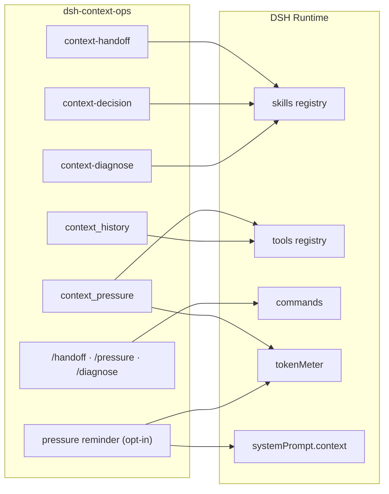

<p align="center">
  
</p>

<p align="center">
  
  
  
  
</p>

<h1 align="center">dsh-context-ops</h1>

<p align="center">
  A <a href="https://github.com/deepseek-ai/deepseek-harness">DeepSeek Harness</a> (<code>dsh</code>) plugin for context management:<br>
  <b>handoff</b>, <b>compaction decision</b> and <b>diagnosis</b> skills, a self-contained <b>pressure tool</b>, and three <b>slash commands</b>.
</p>

> 中文版见 [README.md](README.md)。

---

## Why this plugin

| Problem | What it does |
|---|---|
| Sessions get slower but you don't know when to compact | "Should I compact?" → reads `context_pressure`, applies the ladder, gives one prescription |
| Compaction loses constraints / fails, without a clear reason | "Context diagnosis" → layer-by-layer check + hard rule + three failure causes |
| You re-read old chats across days or sessions | "Handoff" → a 5-line brief written to `CHECKPOINT.md` |
| Readings depend on a machine-specific external script | `context_pressure` reads DSH's built-in `tokenMeter`, so it works anywhere |
| Switching models then compacting still uses the old model | The diagnosis skill says: run one normal turn first, then `/compact` |

## Features

| Capability | Name | Implementation | Notes |
|---|---|---|---|
| Handoff skill | `context-handoff` | `lib/skills/handoff.js` | Writes a 5-line brief (goal / status / next / open / evidence) to `CHECKPOINT.md` |
| Decision skill | `context-decision` | `lib/skills/decision.js` | Reads numbers → applies the ladder → gives **one** prescription |
| Diagnosis skill | `context-diagnose` | `lib/skills/diagnose.js` | One check-up, layer by layer, **full report** |
| Pressure tool | `context_pressure` | `lib/index.js` | Self-contained; also reports window evidence (`windowSource` / `routeKey`) |
| History tool | `context_history` | `lib/index.js` | Peak / last input-side tokens, compaction attempts / successes / failures |
| Slash commands | `/handoff` `/pressure` `/diagnose` | `lib/index.js` | Explicit triggers (skipped when no `commands` service) |
| Pressure reminder (opt-in) | `enableReminder` | `lib/index.js` | Adds one line to the host's runtime-context snapshot; never fakes a user message |
| Compaction model | `compaction-basic` config | documented below | Native DSH fields; **no hard-coded provider/model** |

## Quick start

```sh
# 1) Install (replace <profile> with yours, e.g. desktop / web)
dsh plugin --profile <profile> add dsh-context-ops

# 2) Restart DSH (profile changes take effect on restart)

# 3) Try a trigger
#    "handoff" / "should I compact?" / "context diagnosis"
#    or the slash commands: /handoff  /pressure  /diagnose
```

Local development install:

```sh
dsh plugin --profile <profile> add "file:/absolute/path/to/dsh-context-ops"
```

## Skills

### 1) Handoff `context-handoff`

**Triggers**: handoff, wrap up, archive, checkpoint, resume project, continue last night's project.

**Output**: a five-line `CHECKPOINT.md` table — goal, status, next steps, open questions, evidence.

**When not to use**: 1–2 turn tasks, pure Q&A with no project state, or when the user explicitly says no brief.

### 2) Context decision `context-decision`

**Triggers**: context management, should I compact, should I hand off, what about the context, how much pressure, how much room left.

**Flow**: call `context_pressure` for real numbers, apply the ladder, and give one prescription (what + why + which number); when compaction is possible, **copy `/compact` to the clipboard** (`pbcopy` on macOS, otherwise prompt the user to type it), and when it is not, recommend a handoff.

### 3) Context diagnosis `context-diagnose`

**Triggers**: context diagnosis, diagnose, context check-up, check-up, ctx-check, take a look at my context.

**Output**: a diagnosis report (status / band / can-compact / should-compact / warnings); copies `/compact` to the clipboard when compaction is possible, recommends a handoff otherwise.

## The `context_pressure` tool

Called with no arguments, it returns:

```json
{
  "pressureTokens": 82341,
  "surfaceTokens": 71022,
  "window": 800000,
  "declaredWindow": 1048576,
  "realWindow": 800000,
  "windowInflated": true,
  "windowSource": "override",
  "routeKey": "zicode/deepseek-v4-pro",
  "pct": 10.3,
  "cacheHitRate": 0.995,
  "provider": "zicode",
  "model": "deepseek-v4-pro",
  "note": ""
}
```

| Field | Meaning |
|---|---|
| `pressureTokens` | Total request-body tokens (the real compaction signal) |
| `surfaceTokens` | Surface-only token count |
| `window` | Effective window = `min(declaredWindow, realWindow)`; `null` when unknown |
| `declaredWindow` | Window declared by the route / profile; `null` when unknown |
| `realWindow` | Route limit: **the configured measured value wins**, otherwise the built-in nominal value; `null` when both are unknown |
| `windowInflated` | The declared window exceeds the limit the plugin believes in (`declaredWindow > realWindow`); the meaning depends on `windowSource`, see below |
| `windowSource` | Evidence for the number: `override` measured config / `nominal` built-in nominal / `declared` declaration only / `unknown` |
| `routeKey` | Current route key `provider/model`, the key to use in `realWindows` |
| `pct` | Usage percent = `pressureTokens / window * 100`; `null` when unknown |
| `cacheHitRate` | Cache hit rate (0–1) = `cacheReadTokens / (cacheReadTokens + uncachedInputTokens)`; `null` when unknown |
| `provider` / `model` | Current route; empty string when unknown |
| `note` | Error text when the reading failed; empty otherwise |

> **The plugin does not decide whether a provider is official or a relay.** `provider` is only a profile key; the plugin cannot see the base URL and must not guess. The same model can have different capacity on different routes (manual §1.5). `windowSource=nominal` only means the number is a built-in nominal value and has not been measured on this route.
>
> To make `pct` use measured capacity, add a `provider/model` entry to `realWindows` using the needle test from manual §1.6 and a safe value around 80% of the measured pass (manual §1.2). Unconfigured routes fall back to the old nominal-table behavior.

> A high `cacheHitRate` (near 1) means the prefix is being reused — cheaper and faster first token. A persistently low rate means the context keeps being rewritten (or the provider does not cache), a signal to consider a fresh session.
> It is a **session cumulative** figure: the first cold request is always 0% and dilutes as the session grows.

> `windowInflated` means the declared window exceeds the limit the plugin is using, but **interpret it with `windowSource`**:
>
> - `windowSource=nominal`: the declaration exceeds the model's nominal value. The host still uses the declared window for auto-compaction, so it may never trigger; fix the profile or add a route-specific measurement.
> - `windowSource=override`: the declaration exceeds the **measured safe value** for this route. `pct` uses the measured value, but **host auto-compaction still uses the declaration**, so its trigger is later than the measured safety boundary. To fix host behavior too, set the profile `contextWindow` to the measured value; `realWindows` alone only corrects this plugin's reading.
> - The opposite case is legitimate: deliberately capping a large-window model (1M → 128k) yields `windowInflated=false` and `window` stays at the smaller value.
>
> **Two rulers:** `pct` divides by `window` (which a measured value can narrow), while host auto-compaction divides by `declaredWindow`. When `window` is narrowed, do not infer that auto-compaction is broken just because `pct` passed 80% and nothing was compacted.

> `windowInflated = null` means either the model is not in the built-in table, or this session has no routed window yet. **Both mean "undecidable" — never read it as false/safe.**

> Use `pressureTokens ÷ window` for compaction decisions, **not** the `projectedTokens` shown in the UI (it under-reports).

## History tool `context_history`

Takes no arguments; returns session-level trend and compaction records:

| Field | Meaning |
|---|---|
| `peakTokens` / `lastTokens` | Peak / last-request **input-side tokens** (input + cacheRead + cacheWrite, excluding output) |
| `compactionCount` | Compaction attempts (`compaction/start`) |
| `compactionSuccess` | Successful compactions (`compaction/summary`) |
| `compactionError` | Failed compactions (`compaction/end` carrying `error`) |

> `peakTokens` and `context_pressure.pressureTokens` are **not the same ruler**: the latter includes output budget plus tools/system prompt, so it is systematically larger. Compare trends, never subtract one from the other.

> Why failures are counted that way: the host only persists `compaction/start` / `summary` / `end`, and a failure is recorded as `compaction/end.data.error`. `compaction/summary-error` is merely an in-memory waterfall hook name that never reaches the log — counting it would always yield 0.

## Slash commands

| Command | Equivalent trigger | Effect |
|---|---|---|
| `/handoff` | "handoff" | Starts the 5-line brief flow |
| `/pressure` | "should I compact?" | Calls `context_pressure` and gives a prescription |
| `/diagnose` | "context diagnosis" | Runs the full check-up |

## Decision ladder


**Hard rule**: can compact ⇔ `pressureTokens < window × 0.95`.

**⚠ This ladder is not the host's threshold.** DSH's own `compaction-basic` auto-compacts at
`min(contextWindow × 0.8, contextWindow − reserved output − 65536)` — roughly **838k (80%)** for a 1M
window and **~105k** for a 131k window. In normal automatic mode the "85% → prepare a handoff" band is
usually unreachable: by the time you see 85%, compaction already happened. The ladder here is
**advice** and does not change host behaviour; to move the trigger, configure `thresholdRatio` /
`headroomTokens` on `compaction-basic` in your profile.

**Three failure causes**:
1. `context overflow` → switch to a larger-window model and retry, or hand off;
2. `stream idle timeout` → do not retry; hand off;
3. `summary is not smaller` → already at the limit; ignore; only a new session can reduce it.

## Architecture




## Plugin config

| Key | Default | Meaning |
|---|---|---|
| `enablePressureTool` | `true` | Register `context_pressure` + `context_history` (needs `tokenMeter`; skipped if missing) |
| `enableCommands` | `true` | Register `/handoff` `/pressure` `/diagnose` (needs `commands`; skipped if missing) |
| `enableReminder` | `false` | Active reminder: when pressure ≥ `remindAt`, adds one line to the host's runtime-context snapshot |
| `remindAt` | `85` | Reminder threshold percent (50–95) |
| `handoffAt` | `92` | Forced-handoff line percent (50–95); when pressure ≥ this value the reminder escalates to "execute the handoff automatically" |
| `realWindows` | `{}` | Measured safe windows keyed by `provider/model`; see below |

Unknown keys raise an error (`unknown config key`); known keys of the wrong type (e.g. `enableReminder: "true"`, `remindAt: "70"`) also raise, instead of silently inverting or falling back.

### Measured windows `realWindows` (optional)

The built-in table holds **vendor nominal values**: the same model served through a different route or gateway may have a different usable capacity, so a nominal value does not prove your route accepts that much. To make `pct` reflect measured capacity, add an entry per `provider/model`:

```yaml
- id: context-ops
  name: 'dsh-context-ops'
  config:
    enablePressureTool: true
    enableCommands: true
    enableReminder: false
    remindAt: 85
    handoffAt: 92
    realWindows:
      zicode/deepseek-v4-pro: 800000
      zicode/glm-5.3: 600000
      deepseek-account/deepseek-v4-pro: 1048576
```

Rules:

- **Keys must include the provider** (`provider/model`). A bare model key raises an error: the same model differs per route, so a model-only override would apply one route's measurement to another, which is worse than not configuring it.
- You can copy the key straight from `context_pressure`'s `routeKey`.
- Use roughly **80% of the measured passing value**, not the measured ceiling (manual §1.2); the plugin rounds to an integer.
- The effective window is still `min(declaredWindow, measured)`, so a smaller declared value wins and a measured value never enlarges the window.
- Invalid values (0, negative, a string, a bare model key) fail at load time instead of silently taking effect.
- Routes without an entry keep the previous behavior (nominal table), so upgrading does not change an existing profile.

> ⚠ DSH patches **replace the whole `config` of a matching id**; they do not merge. When overriding the `context-ops` row in your profile, repeat every key, otherwise the others snap back to defaults.

### Active reminder (optional)

When enabled it is evaluated on every request assembly: if `pct ≥ remindAt`, one `system-reminder` line is
attached to the host's **runtime-context snapshot** (`ctx.systemPrompt.context()`).

- **Two tiers**:
  - `pct ≥ remindAt` (default 85%) → **suggest** compaction or handoff;
  - `pct ≥ handoffAt` (default 92%) → **forced handoff**: the model is told to announce that it is executing the handoff and write `CHECKPOINT.md` immediately, so work is saved before the budget runs out.
- **No fake user message** — this is the key point. Injecting into `decision.messages` via `agent/pre-step` looks
  non-persisted, but the host's `step()` appends every non-`runtime-context` message with
  `session.append('user/message')`: the reminder would enter the session history, show up in the
  conversation, and be re-sent on every later request — a context plugin inflating its own context.
- **Text varies by band only**: no exact percentages or token counts (those would rewrite the snapshot every
  single request). It changes when crossing a band (85 → 95) and disappears when pressure falls back.
- **Ignorable**: the text says so and does not affect the conversation; it tells the model to call
  `context_pressure` when it needs exact numbers.
- **Off by default**: only active with `enableReminder: true`.

## Robustness

| Situation | Behavior |
|---|---|
| `tokenMeter` missing | Both tools are skipped (no data source); all three skills still register |
| `commands` missing | Only the slash commands are skipped; skills and tools are unaffected |
| `systemPrompt` missing | Only the active reminder is skipped |
| Tool called with no session | Empty values + `note: no session` (`pressureTokens` stays 0, so **the note matters**) |
| Reading fails | Empty values + a `note`; a reading failure never becomes a conversation failure |
| Reminder evaluation fails | Empty string (nothing injected) plus a `warn` log — code errors are not swallowed silently |

## Compaction model (optional)

This plugin **does not hard-code** a provider/model. To route `/compact` summaries to a specific model, configure `compaction-basic` (native DSH fields) in your own profile `cordis.patch.yml`:

```yaml
- id: compaction-basic
  config:
    summarizationProvider: deepseek-account   # replace with your provider
    summarizationModel: deepseek-v4-pro       # replace with your model
```

Provide both fields or neither; otherwise `compaction-basic` refuses to load.

## Project structure

```
dsh-context-ops/
├── lib/
│   ├── index.js          entry: skills + both tools + slash commands + opt-in reminder
│   ├── policy.js         shared constants (ladder / host threshold / hard rule / failure causes / windows)
│   └── skills/
│       ├── handoff.js    handoff skill
│       ├── decision.js   context decision skill
│       └── diagnose.js   context diagnosis skill
├── locale/               bilingual metadata (en/zh)
├── assets/               README images (hero, ladder)
├── test/                 node --test unit tests
├── cordis.patch.yml      self-registration entry
├── icon.svg              plugin icon
├── CHANGELOG.md          changelog
├── package.json          no dependencies, dsh.bundle manifest
└── README.md / README.en.md
```

## Compatibility

| Item | Requirement |
|---|---|
| Node.js | `>= 20` |
| DSH | 0.2.x (uses `ctx.skills.register` / `ctx.tools.register` / `ctx.commands.register` / `tokenMeter`) |
| Runtime dependencies | 0 (pure ESM, only `node:crypto`) |
| Storage changes | None (no DSH storage schema changes; reversible) |

## Development

```sh
# Unit tests (Node's built-in test runner, no extra dependencies)
npm test

# Syntax check
node --check lib/index.js

# Install into a profile locally
dsh plugin --profile <profile> add "$(pwd)"
```

## Changelog

See [CHANGELOG.md](CHANGELOG.md).

## License

[MIT](LICENSE) © 廷宇
