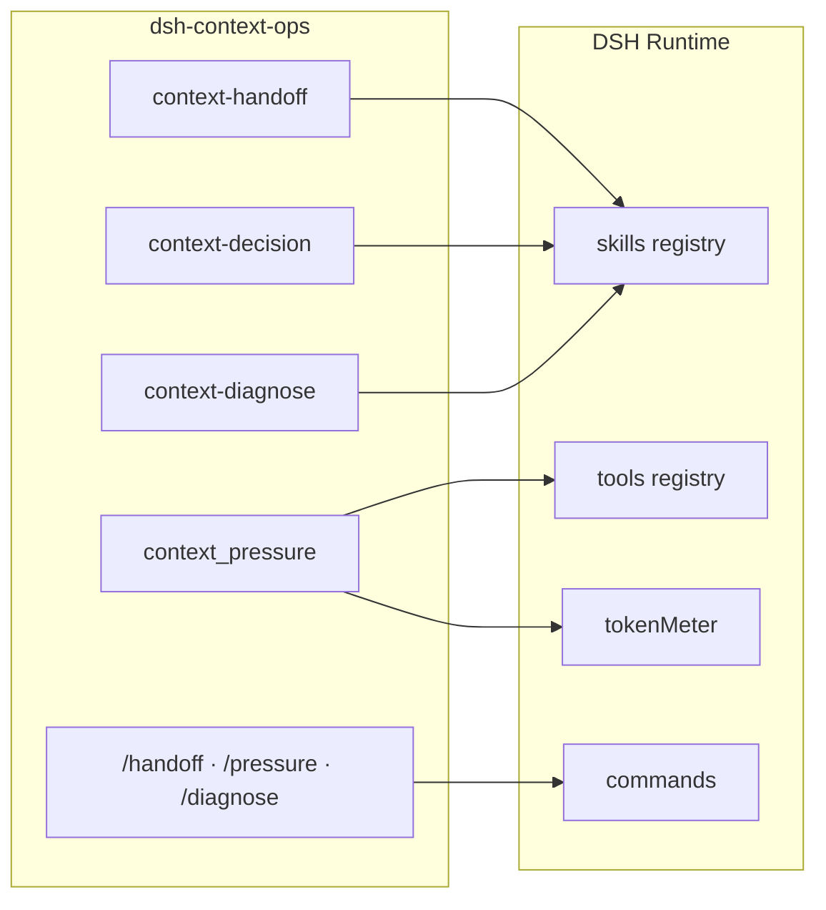
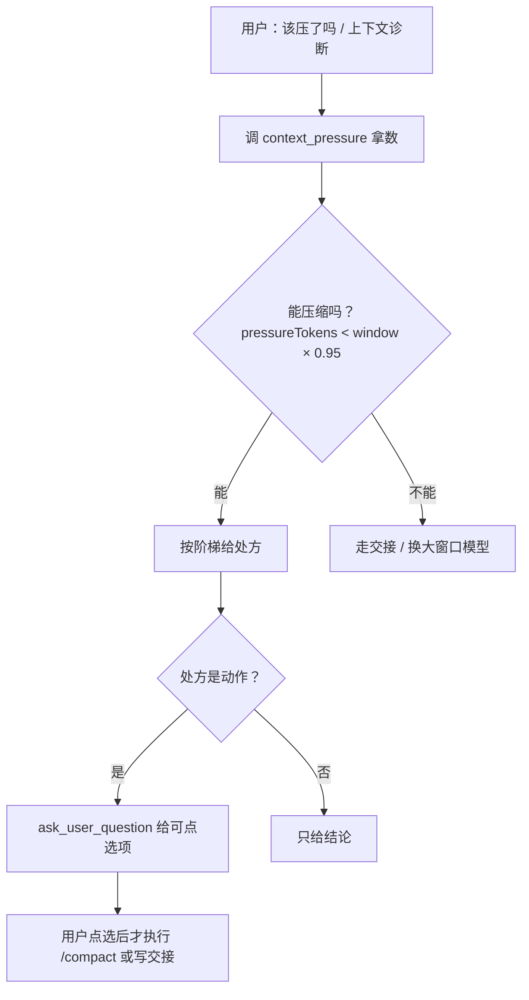

<p align="center">
  
</p>

<p align="center">
  
  
  
  
</p>

<h1 align="center">dsh-context-ops · 上下文运维</h1>

<p align="center">
  给 <a href="https://github.com/deepseek-ai/deepseek-harness">DeepSeek Harness</a>（<code>dsh</code>）的上下文管理插件：<br>
  <b>交接</b>、<b>压缩决策</b>、<b>上下文诊断</b>三个技能 + 自包含<b>压力读数工具</b> + 三个<b>斜杠命令</b>。
</p>

> A DeepSeek Harness plugin for context management: handoff, compaction decision and diagnosis skills, a self-contained pressure tool, and slash commands.
>
> English: [README.en.md](README.en.md)

---

## 为什么需要它

| 你遇到的问题 | 这个插件怎么解 |
|---|---|
| 会话越聊越慢，不知道什么时候该压 | 「该压了吗」→ 调 `context_pressure` 拿数 → 套阶梯 → 一句处方 |
| 压完还是丢约束 / 压不动，不知道为什么 | 「上下文诊断」→ 逐层核对 + 硬判据 + 压缩失败三归因 |
| 换天、换会话要重读旧聊天 | 「交接」→ 5 行 brief 写到 `CHECKPOINT.md`，替代重读 |
| 读数依赖某台机器的外部脚本 | `context_pressure` 工具读 DSH 自带 `tokenMeter`，装哪儿都能用 |
| 换模型后立刻压还是走旧模型 | 诊断技能明确提示：先跑一轮普通对话再 `/compact` |

## 能力一览

| 能力 | 名称 | 实现 | 说明 |
|---|---|---|---|
| 交接技能 | `context-handoff` | `lib/skills/handoff.js` | 产出 5 行 brief（目标/现状/下一步/未决/证据）到 `CHECKPOINT.md` |
| 上下文决策技能 | `context-decision` | `lib/skills/decision.js` | 读数 → 套阶梯 → 给**一句**处方 |
| 上下文诊断技能 | `context-diagnose` | `lib/skills/diagnose.js` | 一次体检，逐层核对，给**完整诊断报告** |
| 压力读数工具 | `context_pressure` | `lib/index.js` | 自包含读数，数据来自 DSH 自带 `tokenMeter` |
| 斜杠命令 | `/handoff` `/pressure` `/diagnose` | `lib/index.js` | 显式触发对应技能（`commands` 服务缺失时自动跳过） |
| 压缩摘要走强模型 | `compaction-basic` 配置 | 文档化（见下） | 走 DSH 原生字段，本插件**不写死**任何账号/模型 |

## 快速开始

```sh
# 1) 安装（把 <profile> 换成你的 profile，如 desktop / web）
dsh plugin --profile <profile> add dsh-context-ops

# 2) 重启 DSH（改 profile 必须重启才生效）

# 3) 选一个触发词试试
#    「交接」 / 「该压了吗」 / 「上下文诊断」
#    或直接用斜杠命令：/handoff  /pressure  /diagnose
```

本地开发安装：

```sh
dsh plugin --profile <profile> add "file:/绝对路径/dsh-context-ops"
```

## 三个技能

### 1) 交接 `context-handoff`

**触发**：交接、收尾、存档、checkpoint、handover、续接项目、继续昨晚的项目。

**产出**：`CHECKPOINT.md` 五行表——目标、现状、下一步、未决、证据。

**什么时候不用**：1–2 轮小任务、纯问答无项目状态、用户明确说不用。

### 2) 上下文决策 `context-decision`

**触发**：上下文管理、该压了吗、要不要交班、上下文怎么办、压力多少、还有多少余量。

**流程**：先调 `context_pressure` 拿真实数字，再按阶梯给一句处方（做什么 + 为什么 + 依据哪个数）。

### 3) 上下文诊断 `context-diagnose`

**触发**：上下文诊断、诊断一下、上下文体检、体检、ctx-check、帮我看看上下文。

**产出**：一份诊断报告（现状 / 落档 / 能压吗 / 处方 / 告警），处方是可点选项。

## 压力读数工具 `context_pressure`

无参数调用，返回：

```json
{
  "pressureTokens": 82341,
  "surfaceTokens": 71022,
  "window": 131072,
  "pct": 62.8,
  "cacheHitRate": 0.995,
  "provider": "zicode",
  "model": "deepseek-v4-pro",
  "note": ""
}
```

| 字段 | 含义 |
|---|---|
| `pressureTokens` | 请求体总 token（判断压缩的真实口径） |
| `surfaceTokens` | 对话面 token |
| `window` | 真实上下文窗口；未知时 `null` |
| `pct` | 占用百分比 = `pressureTokens / window * 100`；窗口未知时 `null` |
| `cacheHitRate` | 缓存命中率（0–1）= `cacheReadTokens / (cacheReadTokens + uncachedInputTokens)`；未知时 `null` |
| `provider` / `model` | 当前路由的 provider / model；未知时为空串 |
| `note` | 读数失败时的错误说明；正常为空串 |

> `cacheHitRate` 高（接近 1）= 前缀被复用，便宜且首 token 快；持续偏低说明上下文在不断被改写（或 provider 不支持缓存），是「该换会话/重开」的信号。

> 判断压缩时用 `pressureTokens ÷ window`，**不要**用界面显示的 `projectedTokens`（偏低）。

## 斜杠命令

| 命令 | 等价触发 | 作用 |
|---|---|---|
| `/handoff` | 「交接」 | 进入 5 行 brief 流程 |
| `/pressure` | 「该压了吗」 | 调 `context_pressure` 给处方 |
| `/diagnose` | 「上下文诊断」 | 一次完整体检 |

## 决策阶梯


**硬判据**：能压缩 ⇔ `pressureTokens < window × 0.95`。

**压缩失败三归因**：
1. `context overflow` → 换大窗口模型再压，或交班；
2. `stream idle timeout` → 别重试，直接交班；
3. `summary is not smaller` → 已到极限，忽略；要降只能新会话。

## 架构





## 插件配置

| 键 | 默认 | 说明 |
|---|---|---|
| `enablePressureTool` | `true` | 是否注册 `context_pressure` 工具（需要 `tokenMeter`，缺失时自动跳过）|
| `enableCommands` | `true` | 是否注册 `/handoff` `/pressure` `/diagnose`（需要 `commands`，缺失时自动跳过）|
| `enableReminder` | `false` | 主动提醒：每轮首步压力 ≥ `remindAt` 时，注入一条不落盘的 system-reminder |
| `remindAt` | `85` | 提醒阈值百分比（50–95）|

未知键会直接报错（`unknown config key`），不静默忽略。

### 主动提醒（可选）

开启后，每轮**首步**检查压力；`pct ≥ remindAt` 时把一条 `system-reminder` 拼进本次请求：

- **不落盘**：只进入本次请求，不写入会话、不触发新回合；
- **去重**：同一会话、同一档位（85 / 95）只提醒一次；压力回落后重置；
- **可忽略**：文案带「可忽略」，不影响正常对话；
- **默认关闭**：`enableReminder: true` 才生效。

## 健壮性

| 场景 | 行为 |
|---|---|
| `tokenMeter` 缺失 | 只跳过 `context_pressure` 工具，三个技能照常注册 |
| `commands` 缺失 | 只跳过斜杠命令，技能与工具照常 |
| 无会话调用工具 | 返回空值（`window: null` / `pct: null`），不抛错 |
| 读数失败 | 返回空值 + `note` 错误说明，不把读数故障变成对话故障 |

## 配置：压缩摘要走强模型（可选）

本插件**不写死** provider/model。如需把 `/compact` 的摘要路由到指定模型，在你自己的 profile `cordis.patch.yml` 里给 `compaction-basic` 配（DSH 原生字段）：

```yaml
- id: compaction-basic
  config:
    summarizationProvider: deepseek-account   # 换成你自己的 provider
    summarizationModel: deepseek-v4-pro       # 换成你自己的 model
```

两个字段要么都空（默认 = 用当前会话模型），要么都填，否则 `compaction-basic` 会拒载。

> **压缩前预处理（DSH 已自带并默认挂载）**：`compaction-tool-result-pruner`（裁剪超大工具结果，模型无关）+ `compaction-image-offload`（超预算图片换成占位符重试）在 `/compact` 时自动参与——先裁剪/卸载，再由摘要模型压。无需本插件额外配置。

## 项目结构

```
dsh-context-ops/
├── lib/
│   ├── index.js          入口：注册技能 + context_pressure 工具 + 斜杠命令
│   ├── policy.js         统一策略常量（阶梯/硬判据/三归因/真实窗口）
│   └── skills/
│       ├── handoff.js    交接技能
│       ├── decision.js   上下文决策技能
│       └── diagnose.js   上下文诊断技能
├── locale/               双语 metadata（en/zh）
├── assets/               README 配图（hero、ladder）
├── test/                 node --test 单元测试
├── cordis.patch.yml      自注册入口
├── icon.svg              插件图标
├── CHANGELOG.md          更新日志
├── package.json          无依赖，dsh.bundle 声明
└── README.md
```

## 兼容性

| 项 | 要求 |
|---|---|
| Node.js | `>= 20` |
| DSH | 0.2.x（使用 `ctx.skills.register` / `ctx.tools.register` / `ctx.commands.register` / `tokenMeter`） |
| 运行时依赖 | 0（纯 ESM，仅用 `node:crypto`） |
| 存储改动 | 无（不改 DSH 存储 schema，可回滚） |

## 开发与测试

```sh
# 单元测试（node 内置 test runner，无需额外依赖）
npm test

# 语法自检
node --check lib/index.js

# 本地装到某个 profile
dsh plugin --profile <profile> add "$(pwd)"
```

## 更新日志

见 [CHANGELOG.md](CHANGELOG.md)。

## License

[MIT](LICENSE) © 廷宇
