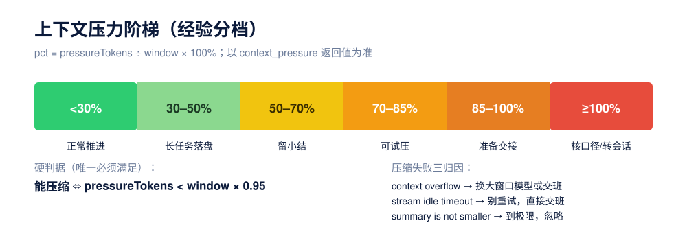
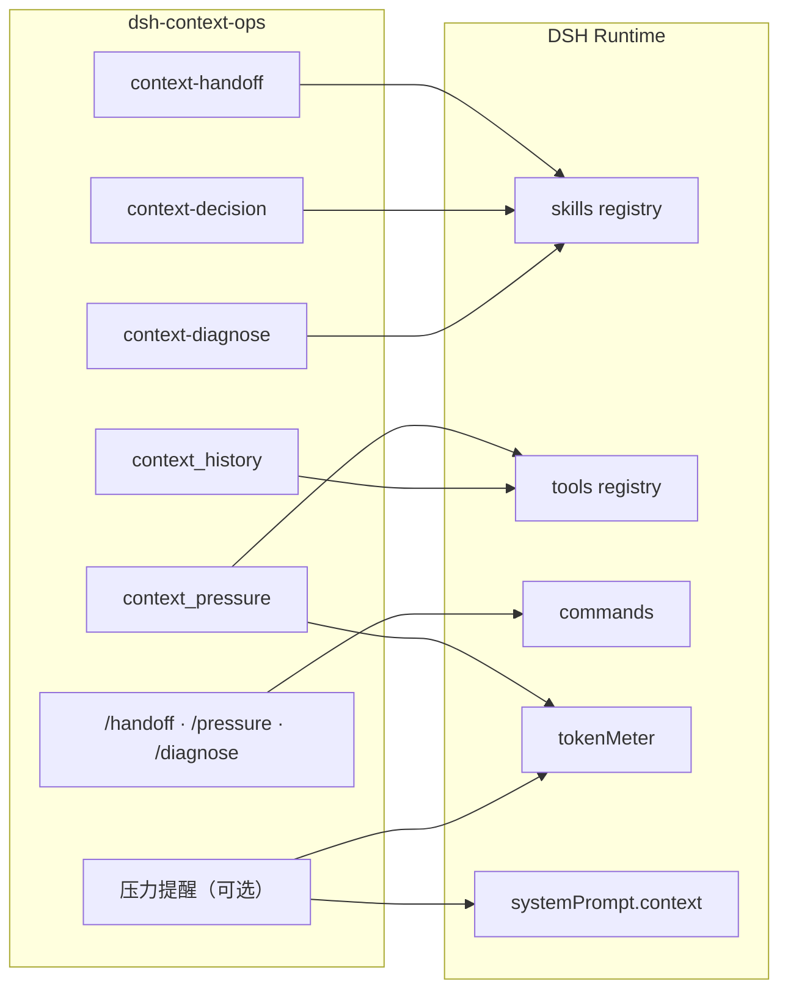
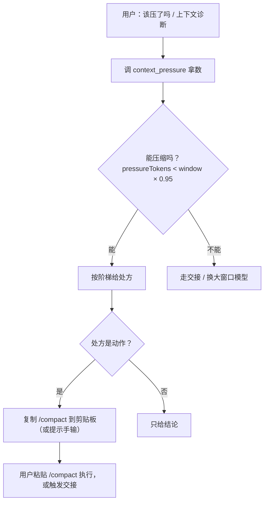

<p align="center">
  
</p>

<p align="center">
  
  
  
  
</p>

<h1 align="center">dsh-context-ops · 上下文运维</h1>

<p align="center">
  给 <a href="https://github.com/deepseek-ai/deepseek-harness">DeepSeek Harness</a>（<code>dsh</code>）的上下文管理插件：<br>
  <b>交接</b>、<b>压缩决策</b>、<b>上下文诊断</b>三个技能 + 自包含<b>压力读数工具</b> + 三个<b>斜杠命令</b>。
</p>

> A DeepSeek Harness plugin for context management: handoff, compaction decision and diagnosis skills, a self-contained pressure tool, and slash commands.
>
> English: [README.en.md](README.en.md)

---

## 为什么需要它

| 你遇到的问题 | 这个插件怎么解 |
|---|---|
| 会话越聊越慢，不知道什么时候该压 | 「该压了吗」→ 调 `context_pressure` 拿数 → 套阶梯 → 一句处方 |
| 压完还是丢约束 / 压不动，不知道为什么 | 「上下文诊断」→ 逐层核对 + 硬判据 + 压缩失败三归因 |
| 换天、换会话要重读旧聊天 | 「交接」→ 5 行 brief 写到 `CHECKPOINT.md`，替代重读 |
| 读数依赖某台机器的外部脚本 | `context_pressure` 工具读 DSH 自带 `tokenMeter`，装哪儿都能用 |
| 换模型后立刻压还是走旧模型 | 诊断技能明确提示：先跑一轮普通对话再 `/compact` |

## 能力一览

| 能力 | 名称 | 实现 | 说明 |
|---|---|---|---|
| 交接技能 | `context-handoff` | `lib/skills/handoff.js` | 产出 5 行 brief（目标/现状/下一步/未决/证据）到 `CHECKPOINT.md` |
| 上下文决策技能 | `context-decision` | `lib/skills/decision.js` | 读数 → 套阶梯 → 给**一句**处方 |
| 上下文诊断技能 | `context-diagnose` | `lib/skills/diagnose.js` | 一次体检，逐层核对，给**完整诊断报告** |
| 压力读数工具 | `context_pressure` | `lib/index.js` | 自包含读数 + 窗口证据（`windowSource` / `routeKey`） |
| 历史/复盘工具 | `context_history` | `lib/index.js` | 峰值、最后一次输入侧 token、压缩尝试/成功/失败次数 |
| 斜杠命令 | `/handoff` `/pressure` `/diagnose` | `lib/index.js` | 显式触发对应技能（`commands` 服务缺失时自动跳过） |
| 主动提醒（可选） | `enableReminder` | `lib/index.js` | 压力过阈值时把一句提示挂进宿主「运行时上下文」快照，不伪造 user 消息 |
| 压缩摘要走强模型 | `compaction-basic` 配置 | 文档化（见下） | 走 DSH 原生字段，本插件**不写死**任何账号/模型 |

## 快速开始

```sh
# 1) 安装（把 <profile> 换成你的 profile，如 desktop / web）
dsh plugin --profile <profile> add dsh-context-ops

# 2) 重启 DSH（改 profile 必须重启才生效）

# 3) 选一个触发词试试
#    「交接」 / 「该压了吗」 / 「上下文诊断」
#    或直接用斜杠命令：/handoff  /pressure  /diagnose
```

本地开发安装：

```sh
dsh plugin --profile <profile> add "file:/绝对路径/dsh-context-ops"
```

## 三个技能

### 1) 交接 `context-handoff`

**触发**：交接、收尾、存档、checkpoint、handover、续接项目、继续昨晚的项目。

**产出**：`CHECKPOINT.md` 五行表——目标、现状、下一步、未决、证据。

**什么时候不用**：1–2 轮小任务、纯问答无项目状态、用户明确说不用。

### 2) 上下文决策 `context-decision`

**触发**：上下文管理、该压了吗、要不要交班、上下文怎么办、压力多少、还有多少余量。

**流程**：先调 `context_pressure` 拿真实数字，再按阶梯给一句处方（做什么 + 为什么 + 依据哪个数）；**能压时把 `/compact` 复制到剪贴板**（macOS `pbcopy`，其他平台提示手输），不能压时建议走交接。

### 3) 上下文诊断 `context-diagnose`

**触发**：上下文诊断、诊断一下、上下文体检、体检、ctx-check、帮我看看上下文。

**产出**：一份诊断报告（现状 / 落档 / 能压吗 / 处方 / 告警）；能压时复制 `/compact` 到剪贴板，不能压时建议交接。

## 压力读数工具 `context_pressure`

无参数调用，返回：

```json
{
  "pressureTokens": 82341,
  "surfaceTokens": 71022,
  "window": 800000,
  "declaredWindow": 1048576,
  "realWindow": 800000,
  "windowInflated": true,
  "windowSource": "override",
  "routeKey": "zicode/deepseek-v4-pro",
  "pct": 10.3,
  "cacheHitRate": 0.995,
  "provider": "zicode",
  "model": "deepseek-v4-pro",
  "note": ""
}
```

| 字段 | 含义 |
|---|---|
| `pressureTokens` | 请求体总 token（判断压缩的真实口径） |
| `surfaceTokens` | 对话面 token |
| `window` | 有效上下文窗口 = `min(declaredWindow, realWindow)`；未知时 `null` |
| `declaredWindow` | 路由 / profile 声明的窗口；未知时 `null` |
| `realWindow` | 该路由的真实上限：**配置的实测值优先**，否则退回内置标称值；都未知时 `null` |
| `windowInflated` | 声明窗口高于插件认定的上限（`declaredWindow > realWindow`）；含义随 `windowSource` 不同，见下 |
| `windowSource` | 这个窗口数字的依据：`override` 实测配置 / `nominal` 内置标称 / `declared` 只有声明值 / `unknown` |
| `routeKey` | 本会话路由键 `provider/model`，即 `realWindows` 里该用的键 |
| `pct` | 占用百分比 = `pressureTokens / window * 100`；窗口未知时 `null` |
| `cacheHitRate` | 缓存命中率（0–1）= `cacheReadTokens / (cacheReadTokens + uncachedInputTokens)`；未知时 `null` |
| `provider` / `model` | 当前路由的 provider / model；未知时为空串 |
| `note` | 读数失败时的错误说明；正常为空串 |

> `windowInflated` 是「声明窗口超过插件认定的上限」的信号，**含义随 `windowSource` 变**：
>
> - `windowSource=nominal`：声明值高于型号标称值。宿主按声明窗口算自动压缩触发点，所以可能永远压不到 —— 属真·虚高，改 profile 或补实测值。
> - `windowSource=override`：声明值高于你在这条线路的**实测安全值**。pct 已按实测值算，但**宿主自动压缩仍按声明值算**，触发点会比实测墙更晚。这时根治是把 profile 的 `contextWindow` 也改成实测值 —— 只填 `realWindows` 只修正了报告，没改宿主行为。
>
> 反过来把大窗口模型特意配小（如 1M 模型限到 128k）是合法限制：`windowInflated=false`，`window` 就是那个小值，不会被放大。

> ⚠ **两把尺子**：`pct` 的分母是 `window`（可能被实测值收窄），宿主自动压缩的分母是 `declaredWindow`（声明值）。所以 `window` 被收窄后，别用「pct 已过 80% 而宿主没压」去推断自动压缩出了问题。

> **插件不判断你的 provider 是官方还是中转**。`provider` 只是 profile 里的键名，插件看不到 baseURL，也不该猜：同一个型号在不同线路上容量可以不同（手册 §1.5）。所以 `windowSource=nominal` 只说明「这个数字来自内置标称值、尚未在本线路实测」，不等于「你走的是中转」。
>
> 想让 pct 按真实容量算，就在 `realWindows` 里按 `provider/model` 填一条实测安全值（用针尖测试，手册 §1.6；取实测值的 ~80%，手册 §1.2）。没填的线路一律退回标称值，行为和旧版一致。

> `cacheHitRate` 高（接近 1）= 前缀被复用，便宜且首 token 快；持续偏低说明上下文在不断被改写（或 provider 不支持缓存），是「该换会话/重开」的信号。
> 注意它是**全会话累计**：第一次冷请求必然 0% 命中，会话越长越被历史稀释。

> `windowInflated = null` 有两种情况：型号不在内置窗口表里，或这个会话还没有过路由窗口记录。**都表示「无法判断」，不要当成 false 当作安全**。

> 判断压缩时用 `pressureTokens ÷ window`，**不要**用界面显示的 `projectedTokens`（偏低）。

## 历史复盘工具 `context_history`

无参数调用，返回会话级的趋势与压缩记录：

| 字段 | 含义 |
|---|---|
| `peakTokens` / `lastTokens` | 历史峰值 / 最后一次请求的**输入侧 token**（input + cacheRead + cacheWrite，不含输出） |
| `compactionCount` | 压缩尝试次数（`compaction/start`）|
| `compactionSuccess` | 压缩成功次数（`compaction/summary`）|
| `compactionError` | 压缩失败次数（`compaction/end` 且带 `error`）|

> `peakTokens` 和 `context_pressure.pressureTokens` **不是同一把尺子**：后者含输出预算与工具/系统提示，系统性更大。趋势可以比，两个数不能相减。

> 失败为什么这么算：宿主只有 `compaction/start` / `summary` / `end` 三种落盘事件，失败记在 `compaction/end.data.error` 上；`compaction/summary-error` 只是内存里的 waterfall 钩子名，不落盘，数它永远是 0。

## 斜杠命令

| 命令 | 等价触发 | 作用 |
|---|---|---|
| `/handoff` | 「交接」 | 进入 5 行 brief 流程 |
| `/pressure` | 「该压了吗」 | 调 `context_pressure` 给处方 |
| `/diagnose` | 「上下文诊断」 | 一次完整体检 |

## 决策阶梯



**硬判据**：能压缩 ⇔ `pressureTokens < window × 0.95`。

**⚠ 但这张表不是宿主的阈值。** DSH 自己的 `compaction-basic` 默认在
`min(contextWindow × 0.8, contextWindow − 预留 output − 65536)` 就自动压缩——
1M 窗口约 **838k（80%）**、131k 窗口约 **105k**。也就是说正常自动模式下，「85% 才准备交接」这一档
通常轮不到人动手：等你看到 85%，压缩早已发生。本插件的阶梯是**建议**，不改变宿主行为；
要改触发点，去 profile 里配 `compaction-basic` 的 `thresholdRatio` / `headroomTokens`。

**压缩失败三归因**：
1. `context overflow` → 换大窗口模型再压，或交班；
2. `stream idle timeout` → 别重试，直接交班；
3. `summary is not smaller` → 已到极限，忽略；要降只能新会话。

## 架构





## 插件配置

| 键 | 默认 | 说明 |
|---|---|---|
| `enablePressureTool` | `true` | 是否注册 `context_pressure` + `context_history` 两个工具（需要 `tokenMeter`，缺失时自动跳过）|
| `enableCommands` | `true` | 是否注册 `/handoff` `/pressure` `/diagnose`（需要 `commands`，缺失时自动跳过）|
| `enableReminder` | `false` | 主动提醒：压力 ≥ `remindAt` 时，把一句提示挂进宿主「运行时上下文」快照 |
| `remindAt` | `85` | 提醒阈值百分比（50–95）|
| `handoffAt` | `92` | 强制交接线百分比（50–95）；压力 ≥ 此值时提醒升级为「自动执行交接」|
| `realWindows` | `{}` | 按 `provider/model` 填的实测安全窗口，见下 |

未知键直接报错（`unknown config key`）；已知键类型写错（如 `enableReminder: "true"`、`remindAt: "70"`）也报错，不静默取反或回落。

### 实测窗口 `realWindows`（可选）

内置表只是**型号标称值**：同一个型号经不同线路/代理，容量可能不一样，所以标称值不能代表你的线路真能吃下。要按实测算 pct，就按 `provider/model` 填一条：

```yaml
- id: context-ops
  name: 'dsh-context-ops'
  config:
    enablePressureTool: true
    enableCommands: true
    enableReminder: false
    remindAt: 85
    handoffAt: 92
    realWindows:
      zicode/deepseek-v4-pro: 800000
      zicode/glm-5.3: 600000
      deepseek-account/deepseek-v4-pro: 1048576
```

规则：

- **键必须带 provider**（`provider/model`）。只写型号会报错——同一型号在不同线路容量不同，按型号覆盖会把一条线路的实测值错用到另一条上，比不填更糟。
- 键可以直接用 `context_pressure` 返回的 `routeKey`，不用自己拼。
- 值取**实测通过值的 ~80%**，别贴着实测上限（手册 §1.2）；插件会取整。
- 有效窗口仍取 `min(声明窗口, 实测值)`：声明偏小时以声明为准，实测值不会把窗口放大。
- 值填错（0、负数、字符串、只写型号）在加载时就报错，不会静默生效。
- 没填的线路完全退回旧行为（标称值），所以升级不影响现有 profile。

> ⚠ 注意 DSH patch 的语义是**同 id 整段替换 config**，不是合并：在 profile 里覆盖 `context-ops` 这一行时，其它键也要一起写全，否则会打回默认值。

### 主动提醒（可选）

开启后，每次装配请求时求值一次：`pct ≥ remindAt` 就把一句 `system-reminder` 挂进宿主的
**运行时上下文快照**（`ctx.systemPrompt.context()`）。

- **两档行为**：
  - `pct ≥ remindAt`（默认 85%）→ **建议**压缩或交接；
  - `pct ≥ handoffAt`（默认 92%）→ **强制交接**：提醒模型「上下文压力已过交接线，我现在自动执行交接、写出 `CHECKPOINT.md`」，先落盘再继续，避免等额度耗尽。
- **不伪造 user 消息**：这是关键。走 `agent/pre-step` 往 `decision.messages` 里塞消息看着像「不落盘」，
  但宿主 `step()` 会把每一条非 `runtime-context` 的消息 `session.append('user/message')` ——
  提醒会进会话历史、出现在对话里、之后每个请求都重发，等于上下文插件自己给自己加压力。
- **只按档位变文案**：文本里不带精确百分比和 token 数（那会让快照每轮重写）。跨档（85 → 95）才变；
  压力回落自动消失。
- **可忽略**：文案带「可忽略」，不影响正常对话；要精确数字让它调 `context_pressure`。
- **默认关闭**：`enableReminder: true` 才生效。

## 健壮性

| 场景 | 行为 |
|---|---|
| `tokenMeter` 缺失 | 跳过两个工具（读数没数据源），三个技能照常注册 |
| `commands` 缺失 | 只跳过斜杠命令，技能与工具照常 |
| `systemPrompt` 缺失 | 只跳过主动提醒，其余照常 |
| 无会话调用工具 | 返回空值 + `note: no session`（`pressureTokens` 仍是 0，所以**必须看 note**）|
| 读数失败 | 返回空值 + `note` 错误说明，不把读数故障变成对话故障 |
| 提醒求值失败 | 返回空串（不注入），并留一条 `warn` 日志，不静默吞掉代码错误 |

## 配置：压缩摘要走强模型（可选）

本插件**不写死** provider/model。如需把 `/compact` 的摘要路由到指定模型，在你自己的 profile `cordis.patch.yml` 里给 `compaction-basic` 配（DSH 原生字段）：

```yaml
- id: compaction-basic
  config:
    summarizationProvider: deepseek-account   # 换成你自己的 provider
    summarizationModel: deepseek-v4-pro       # 换成你自己的 model
```

两个字段要么都空（默认 = 用当前会话模型），要么都填，否则 `compaction-basic` 会拒载。

> **压缩前预处理（DSH 已自带并默认挂载）**：`compaction-tool-result-pruner`（裁剪超大工具结果，模型无关）+ `compaction-image-offload`（超预算图片换成占位符重试）在 `/compact` 时自动参与——先裁剪/卸载，再由摘要模型压。无需本插件额外配置。

## 项目结构

```
dsh-context-ops/
├── lib/
│   ├── index.js          入口：注册技能 + 两个工具 + 斜杠命令 + 可选提醒
│   ├── policy.js         统一策略常量（阶梯/宿主阈值/硬判据/三归因/真实窗口）
│   └── skills/
│       ├── handoff.js    交接技能
│       ├── decision.js   上下文决策技能
│       └── diagnose.js   上下文诊断技能
├── locale/               双语 metadata（en/zh）
├── assets/               README 配图（hero、ladder）
├── test/                 node --test 单元测试
├── cordis.patch.yml      自注册入口
├── icon.svg              插件图标
├── CHANGELOG.md          更新日志
├── package.json          无依赖，dsh.bundle 声明
└── README.md
```

## 兼容性

| 项 | 要求 |
|---|---|
| Node.js | `>= 20` |
| DSH | 0.2.x（使用 `ctx.skills.register` / `ctx.tools.register` / `ctx.commands.register` / `tokenMeter`） |
| 运行时依赖 | 0（纯 ESM，仅用 `node:crypto`） |
| 存储改动 | 无（不改 DSH 存储 schema，可回滚） |

## 开发与测试

```sh
# 单元测试（node 内置 test runner，无需额外依赖）
npm test

# 语法自检
node --check lib/index.js

# 本地装到某个 profile
dsh plugin --profile <profile> add "$(pwd)"
```

## 更新日志

见 [CHANGELOG.md](CHANGELOG.md)。

## License

[MIT](LICENSE) © 廷宇
